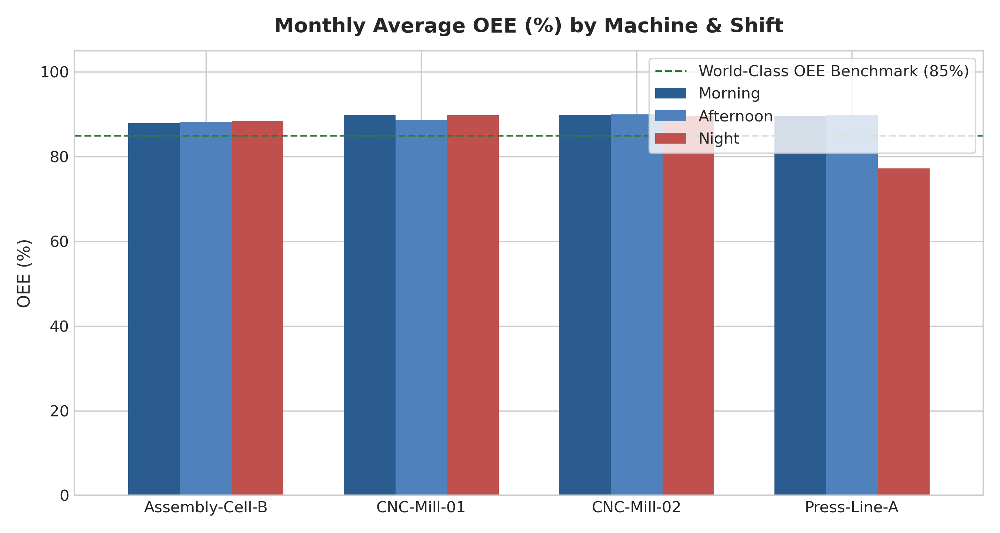
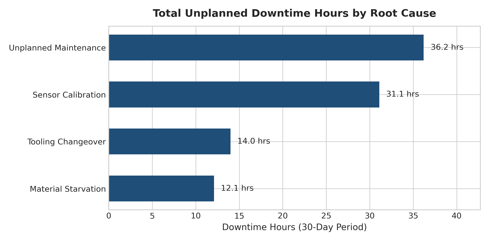

# Automated Monthly OEE & Downtime Reporting Engine

## Executive Summary
Manufacturing supervisors and plant engineers frequently lose hours every reporting cycle consolidating daily shift logs, checking data validity, calculating Availability, Performance, and Quality by hand, and building summary charts.

This project provides a **code-first, license-free Python reporting pipeline** that ingests daily shift logs, flags invalid records into an audit tab, computes **Overall Equipment Effectiveness (OEE)** across machines and shifts, and outputs both a multi-sheet Excel workbook and executive charts.

$$\text{OEE} = \text{Availability} \times \text{Performance} \times \text{Quality}$$

## Workflow & Architecture
* **`generate_shift_logs.py`** — Generates 30 days of synthetic daily shift logs (`raw_shift_logs/`) across multiple machines and shifts, including realistic downtime causes and a Night-shift bottleneck on `Press-Line-A`.
* **`oee_pipeline.py`** — Consolidates daily CSVs, enforces validation rules (such as non-negative values, downtime not exceeding planned shift time, and scrap not exceeding total units), computes OEE components, and exports:
  * `outputs/Monthly_OEE_Executive_Report.xlsx` (`Machine_OEE_Summary`, `Shift_OEE_Matrix`, `Downtime_Pareto`, `Validated_Shift_Logs`, and `Audit_Rejected_Rows`)
  * `assets/oee_by_machine_shift.png`
  * `assets/downtime_pareto.png`

## Key Visuals

### OEE by Machine & Shift


### Downtime Root-Cause Pareto


## How to Run
1. Install dependencies:
   ```bash
   pip install pandas openpyxl matplotlib